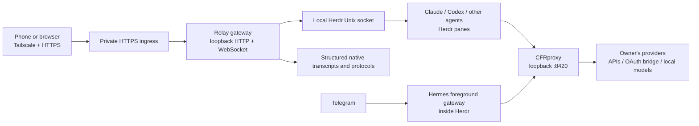

# Agent-run installation: Relay + CFRproxy + Herdr + Hermes + Tailscale

This is the entry point for a Codex or Claude Code agent installing the stack for a new owner on **their own Linux server**. No machine named Fred, original operator account, existing proxy credentials, or access to the original tailnet is required. The owner must use their own provider accounts and Telegram bot credentials.

**Deployment rules:** Tailscale must run on the server and every device accessing the private app. HTTPS with a browser-trusted certificate is mandatory. Every coding-agent process, including the foreground Hermes Telegram gateway, must run inside a Herdr pane. Herdr owns their persistence and lifecycle. Systemd manages infrastructure (Relay, CFRproxy, tailscaled), not a duplicate copy of those agent processes.

## Give this instruction to the installation agent

> Install and validate Relay, CFRproxy, Herdr, and Hermes Telegram integration on this server. Read `docs/AGENT_INSTALL.md` from Relay branch `feat/universal-agent-remote` before doing anything. Discover this machine's real Unix user, home, architecture, Tailscale DNS name, Herdr socket and workspace IDs. Never copy Fred's paths, names, sockets, keys or domains. Require Tailscale and valid HTTPS. Start every agent and the Hermes foreground Telegram gateway inside Herdr. Give every Hermes profile CFRproxy access in Telegram's model selector, including the default profile. Preserve existing configuration, services and sessions. Use installed schemas/help as authoritative; back up edits, validate each layer independently, and report actual adapter limits. If setup fails, investigate and fix safely; file a sanitized GitHub issue with evidence if a project defect blocks completion. Do not claim success until the acceptance checks pass. Never publish credentials in files committed to GitHub, issues, chat, screenshots, or logs.

## 1. Repository access and correct revision

Relay: <https://github.com/crogers2287/harnessrc> (public). CFRproxy: <https://github.com/crogers2287/cfrproxy> (private; accept your repository invitation first). Sign in with the recipient's GitHub account, not the original operator's token. Repository access does not provide API/provider accounts or access to anyone else's server.

Relay's default branch may still be the environment scaffold. **Clone the implementation branch explicitly** until the implementation PR is merged:

```bash
gh auth status
git clone --branch feat/universal-agent-remote https://github.com/crogers2287/harnessrc.git "$HOME/harnessrc"
git clone https://github.com/crogers2287/cfrproxy.git "$HOME/cfrproxy"
git -C "$HOME/harnessrc" rev-parse HEAD
git -C "$HOME/cfrproxy" rev-parse HEAD
```

If the directory exists, inspect `git status` and its remote/branch before proceeding. Never overwrite changes or use `git reset --hard`. Record both SHAs in the installation report. Do not copy the original server's `.cfrproxy`, `.claude`, `.codex`, `.hermes`, `.config/relay`, or SQLite databases.

## 2. Architecture and responsibilities



Relay provides conversation UI, uploads, interaction cards, task lists, sub-agent views, durable queues, and authorization. It does not replace Herdr or perform inference. CFRproxy routes inference and translates API dialects; it does not supervise the agents. Hermes owns Telegram sessions and its model picker. A proxy model appearing in `/models` does not prove it supports tool calls, vision, or the chosen harness.

Prefer one Unix account and one server for the first installation. It lets the gateway reach private Herdr sockets, transcripts, projects, and attachment files directly. A second host needs its own reachable provider endpoint and native session integration; adding a remote hostname to JSON does not forward a local Unix socket or make remote filesystem browsing work.

## 3. Inventory before changes

Record: OS/version and architecture; `id -un`; `HOME`; `hostname`; executable locations/versions for Node, npm, Go, Git, Tailscale, Herdr, Claude, Codex, Hermes; existing user/system services; occupied ports; existing profiles and gateways; target project root; DNS-zone ownership; certificate method; owner-approved default model and permissions.

```bash
uname -m
node --version
npm --version
go version
tailscale version
tailscale status
herdr --version
herdr api schema --json > /tmp/herdr-installed-schema.json
herdr integration status
systemctl --user list-units --type=service
ss -ltn
```

Missing software: use the official installation instructions and verify downloaded installers/checksums. Relay requires **Node >=22.20**, npm and Python 3 for the hook installer. CFRproxy's checked-in `go.mod` is authoritative (currently Go >=1.22.2). Ubuntu distro Node packages may be too old; verify the exact binary used by systemd, not just the interactive shell. Android builds additionally need JDK 21 and Android SDK 36; they are optional for gateway installation.

Official references: [Herdr install](https://herdr.dev/docs/install/), [Herdr agent guide](https://herdr.dev/agent-guide.md), [Tailscale Linux installation](https://tailscale.com/download/linux), [Node downloads](https://nodejs.org/en/download), [Go install](https://go.dev/doc/install), [Hermes documentation](https://hermes-agent.nousresearch.com/docs/).

## 4. Tailscale and HTTPS are prerequisites

1. Install Tailscale on the server, enable/start `tailscaled`, and run `sudo tailscale up`. The owner completes login to **their own tailnet**. Do not invent an auth key or assume permission to join another owner's network.
2. Install/sign in to the same tailnet on phones, computers, and any second agent/provider host. Enable MagicDNS and HTTPS certificates in the tailnet admin settings.
3. Discover the server's actual `Self.DNSName` using `tailscale status --json` and trim its trailing dot. The resulting name might be `agentbox.example-tail.ts.net`; never assume it is Fred.
4. Select a UI origin and a distinct private API origin. Recommended: `https://<actual-ts-name>` for UI and `https://<actual-ts-name>:11543` for the verified tailnet transport. A custom UI subdomain is covered in section 12.
5. Verify current `tailscale serve --help`, access grants and HTTPS port support before publishing. Preserve existing Serve configuration; never use `serve reset` or enable Funnel as an installation shortcut.

```bash
tailscale status --json
# After Relay is configured and running:
tailscale serve --bg --https=443 --yes http://127.0.0.1:4080
tailscale serve --bg --https=11543 --yes http://127.0.0.1:4081
tailscale serve status
```

These commands serve only within the tailnet. Port 4080 is the ordinary paired gateway; port 4081 is the special verified-Tailscale listener. The UI probes the private HTTPS endpoint and uses it for HTTP and WebSockets without pairing when the actual tailnet peer is verified. Do not point a public reverse proxy at 4081. Tailscale grants must permit the intended clients to reach the selected HTTPS ports. Do not replace an existing tailnet policy wholesale.

**Trust boundary:** currently every authorized node reaching Relay's verified private listener receives administrator/control capabilities. This is powerful access, not merely a public transcript view. Limit reachability to the owner's intended devices. A revoked device or an off-tailnet device must not gain control by forging forwarding headers. Keep Herdr sockets private and raw application ports on loopback.

Plain `http://100.x.y.z:4080`, an invalid certificate, or accepting a browser TLS warning is not a production setup. Microphone recording, clipboard APIs, installability and other secure-context features require trusted HTTPS. Native Android release networking requires HTTPS. Tailscale is transport/access control, not a substitute for TLS or model API credentials. Telegram itself uses Telegram's internet service; its gateway's access to local/private inference is the part controlled by this topology.

See [Tailscale HTTPS certificates](https://tailscale.com/docs/how-to/set-up-https-certificates) and [Relay security](SECURITY.md).

## 5. Install CFRproxy as local inference infrastructure

```bash
cd "$HOME/cfrproxy"
go build -o cfrproxy .
install -m755 cfrproxy "$HOME/.local/bin/cfrproxy"
mkdir -p "$HOME/.config/systemd/user" "$HOME/.cfrproxy"
chmod 700 "$HOME/.cfrproxy"
```

Create `~/.config/systemd/user/cfrproxy.service`:

```ini
[Unit]
Description=CFRproxy local model router
After=network-online.target
Wants=network-online.target

[Service]
ExecStart=%h/.local/bin/cfrproxy serve --addr 127.0.0.1:8420
Restart=on-failure
RestartSec=3
UMask=0077
NoNewPrivileges=true

[Install]
WantedBy=default.target
```

```bash
systemctl --user daemon-reload
systemctl --user enable --now cfrproxy.service
curl --fail --silent http://127.0.0.1:8420/health
```

Preserve an existing service and database. Read the installed binary's help before resetting passwords or modifying provider settings. First-run admin bootstrap/password handling varies by revision; retrieve it locally and store it in the owner's secure credential store. Never publish it or a proxy database. Back up the SQLite database together with `secret.key`; encryption without the matching key cannot be restored. Keep backups private.

Add the owner's providers in the authenticated local WebUI `http://127.0.0.1:8420/admin/` (use an SSH/Tailscale private tunnel if administering remotely). For a cloud provider enter the owner's key, correct base URL, default model and restrictions. For a local OpenAI/Ollama endpoint use its actual reachable URL. Do not copy provider names or model IDs from another person's catalog.

```bash
cfrproxy provider list
cfrproxy models
cfrproxy test --name ACTUAL_PROVIDER --prompt 'Reply only CFR_OK'
curl --fail --silent http://127.0.0.1:8420/v1/models
```

Inspect the trace to verify the selected provider/model, streaming and tool compatibility; model-name fallback can otherwise silently route to a provider default. Avoid adding imaginary model aliases to fix a failed catalog.

For subscription OAuth, install and configure the upstream CLIProxyAPI described by CFRproxy's `docs/oauth.md`, then run the supported login and `cfrproxy oauth scan`/`--apply` flow. Subscription OAuth tokens are not cloud API keys. CLIProxyAPI's bcrypt management-secret hash is not the plaintext management password. Keep both control-plane credentials and OAuth files private. OAuth is optional: API keys or local providers are a simpler first smoke test.

For multi-host inference, keep CFRproxy on loopback and publish a separate HTTPS Tailscale Serve endpoint. Reverse-proxied CFRproxy routes require the appropriate data-plane key; scoped `/e/<name>/v1` endpoints always require their own key. Tailscale alone does not turn remote CFRproxy into a keyless endpoint. Do not share its admin password or upstream keys. The current sync script's dummy `cfrproxy` key works for **local loopback**, not an authenticated remote share. See CFRproxy `docs/share-endpoints.md` before adapting remote profiles.

## 6. Herdr is mandatory for all agent sessions

Install Herdr using its official installer, verify its schema, and start/attach Herdr as the same Unix user that will run Relay. Create a project workspace and panes. All Claude/Codex/Hermes/OMP/Pi/OpenCode agent processes must be launched **from these panes**, or from Relay's supported launcher which asks Herdr to create/start them.

```bash
herdr --version
herdr integration install claude
herdr integration install codex
herdr integration install hermes
herdr integration status
herdr
```

Only install integration targets reported by the installed version. Capture `HERDR_SOCKET_PATH` and `HERDR_PANE_ID` from a shell **inside the actual Herdr pane**. Run `herdr api snapshot` against that session and record real workspace IDs. Named Herdr sessions can have different sockets; never substitute an example `~/.config/herdr/herdr.sock` without checking it exists, is owned by the account, and is a private Unix socket.

Infrastructure services do not count as agent sessions: Relay/CFRproxy/tailscaled use systemd. Agent persistence stays in Herdr. Do not simultaneously run the same Hermes bot gateway under systemd and in a Herdr pane; two Telegram pollers can break delivery. Do not attach a second Codex writer/app-server to a thread already owned by a CLI.

## 7. Wire Claude and Codex to CFRproxy

### Claude Code

In a Herdr pane, choose a real provider/model ID from CFRproxy:

```bash
cd "$HOME/projects/ACTUAL_PROJECT"
cfrproxy claude --model ACTUAL_PROVIDER/ACTUAL_MODEL
```

The wrapper sets the native base URL and model. For a direct native launch, configure `ANTHROPIC_BASE_URL=http://127.0.0.1:8420`, the model, and a nonempty local token without overriding unrelated Claude settings. Real remote/share endpoints require their real key. Inspect actual traces instead of assuming a shell alias preserved your environment.

Install Relay's steering and AskUserQuestion hooks after the gateway is running:

```bash
python3 "$HOME/harnessrc/scripts/install-claude-steering.py" \
  --release "$HOME/harnessrc" --socket "$HOME/.local/state/relay/hooks.sock"
```

This preserves other hooks, registers exact main-process question routing, and backs up settings. Load changed hooks according to the installed Claude version; already-open native prompts cannot be attached retroactively. Do not restart busy sessions. The separate documented PermissionRequest hook in `deploy/claude-hooks.example.json` can be merged for command/file approvals: use real absolute Node/tsx/script paths, preserve hooks, and never replace settings wholesale. See [Claude hook behavior](claude-steering.md).

### Codex: provider choice matters

Codex can ignore `OPENAI_BASE_URL` while its built-in ChatGPT provider is selected. Configure a **named native provider**; do not treat one environment variable as sufficient. Back up `~/.codex/config.toml`, then merge:

```toml
[model_providers.cfrproxy]
name = "CFRproxy"
base_url = "http://127.0.0.1:8420/v1"
wire_api = "responses"
env_key = "OPENAI_API_KEY"
```

Use only one existing table of that name. The installed CFRproxy wrapper supplies native provider overrides; alternatively launch explicitly inside Herdr:

```bash
OPENAI_API_KEY=cfrproxy codex \
  -c 'model_provider="cfrproxy"' \
  --model ACTUAL_PROVIDER/ACTUAL_MODEL
```

Here `cfrproxy` is a dummy nonempty token for the owner's loopback proxy, not a real credential. Use real credentials for secured remote endpoints. Verify `/v1/responses` compatibility and tool calls in the proxy traces.

Existing CLI sessions offer only capabilities their verified adapter supports. Rich Codex native questions/steering require a supported existing daemon connection or a new sole-writer bridge. Follow [native Codex bridge instructions](DEPLOYMENT.md#codex-sole-writer-bridge-launched-inside-herdr): start the bridge in a new Herdr pane, register its exact printed native ID/socket, and leave Herdr owning it. Do not resume somebody's live CLI-owned thread in a second app-server. Daemon sockets are account-private and machine-specific; do not copy a `/tmp/codex-daemon-1000/...` path from another machine.

## 8. Install Relay and generate this machine's configuration

```bash
cd "$HOME/harnessrc"
npm ci
npm run build
mkdir -p "$HOME/.config/relay" "$HOME/.local/state/relay" "$HOME/projects"
chmod 700 "$HOME/.config/relay" "$HOME/.local/state/relay"
```

From the inventory, choose real HTTPS origins, Herdr socket and workspace. The renderer validates the checked-in Zod schemas and prints JSON; it does not invent socket/workspace values or contact the original operator's server:

```bash
umask 077
node --import tsx scripts/render-install-config.ts \
  --socket /ACTUAL/PRIVATE/HERDR.sock \
  --workspace ACTUAL_WORKSPACE_ID \
  --origin https://ACTUAL_SERVER.ACTUAL_TAILNET.ts.net \
  --tailnet-origin https://ACTUAL_SERVER.ACTUAL_TAILNET.ts.net:11543 \
  > "$HOME/.config/relay/config.candidate.json"
```

Review the candidate before activation. If `config.json` exists, back it up privately and merge; do not replace a config that already manages sessions. For a fresh install, activate the reviewed candidate with `install -m600 "$HOME/.config/relay/config.candidate.json" "$HOME/.config/relay/config.json"`. Output uses `hostId: local`, this user's home/transcript/project roots, localhost CFRproxy, and Claude/Codex launch profiles. It intentionally omits guessed Codex daemon paths, other hosts, unsafe full-access presets, provider keys, voice servers and DSH tokens.

Choose an actual supported default model in each launch profile's `defaultModel`, or explicitly choose one in the app. Do not copy an unrelated account default into CFRproxy. The model catalog URL is loopback and includes all enabled proxy models. Permission presets are trusted installation configuration; the app chooses supported values, not arbitrary CLI flags. Test permission readback before sending the first task.

Copy `deploy/relay.service` into `~/.config/systemd/user/relay.service`, then adapt it:

- `WorkingDirectory` must be this checkout.
- `ExecStart` must use this machine's actual supported Node executable; an interactive nvm PATH is not inherited by systemd.
- Add `Environment=RELAY_CFR_ANTHROPIC_URL=http://127.0.0.1:8420` and `Environment=RELAY_CFR_LOCAL_TOKEN=cfrproxy` for the generated launch profiles. These are a local URL and dummy token, not upstream secrets.
- Set a usable PATH for Herdr's agent binaries and the gateway diagnostics, preserving system paths.
- If actual Herdr/Codex sockets live in `/tmp`, `PrivateTmp=true` hides them from the service. Use a reviewed `PrivateTmp=false` drop-in for this same-user private-socket deployment, or supported persistent socket locations. Do not copy/move active socket files.

The service must have write access to the project's allowlisted roots and its state directory. `ProtectHome=read-only` without appropriate `ReadWritePaths` prevents new-folder creation. The supplied template permits the user's home; narrow it to dedicated project/state directories if desired.

```bash
systemctl --user daemon-reload
systemctl --user enable --now relay.service
RC_CONFIG="$HOME/.config/relay/config.json" npm run diagnose -- --live
curl --fail --silent http://127.0.0.1:4080/health
```

Diagnose both Herdr and optional native Codex schemas; do not skip a failed ownership/socket check. Enable lingering only for the chosen service account with owner/admin authorization when services must survive logout. Phone disconnects must not interrupt agent execution.

## 9. Hermes Telegram: every profile must have CFRproxy in `/model`

This is a required outcome, not an optional aside. Install Hermes from its official instructions. Create/configure the owner's profiles and Telegram credentials using the installed Hermes CLI. Each profile needs the intended bot/chat authorization; separate bots need distinct tokens. Detect whether the installed Hermes version multiplexes profiles through one gateway or uses separate gateways; do not assume the old topology.

Run the foreground gateway **inside a Herdr pane** using the installed supported `hermes gateway run` (or named-profile form). On current multiplexing versions, one foreground gateway can own all eligible profiles. Check `hermes gateway status` and named-profile status before starting anything. If a service already owns it, schedule a deliberate transition rather than creating a duplicate poller. All agent CLI sessions also start in Herdr. Telegram sessions are logical sessions owned by the supervised Hermes gateway; they are not separate terminal processes.

### Portable baseline: one dynamic CFRproxy provider per profile

Back up and merge into the **default** `~/.hermes/config.yaml` and **every** `~/.hermes/profiles/<name>/config.yaml`, or the installed supported provider structure:

```yaml
custom_providers:
  - name: cfrproxy
    base_url: http://127.0.0.1:8420/v1
    api_key: cfrproxy
    api_mode: chat_completions
    discover_models: true
```

Keep existing providers. Do not add a second `custom_providers` YAML key. The dummy key is valid only for local loopback. Live `/v1/models` IDs include `provider/model`; choosing a Hermes provider called `cfrproxy` may yield a fully qualified selector such as `cfrproxy/actual-provider/actual-model`. Check the installed picker rather than assuming a static model ID. An existing session's default may remain unchanged until `/model` is used in that conversation.

### Optional nested group → provider → model picker

CFRproxy includes `scripts/sync_hermes_cfrproxy.py`. Read it **at the checked-out revision** before running. It creates scoped provider entries pointing to `/p/<provider>/v1`, adds router/fusion groups where available, preserves unrelated entries and backs up edited files. It also patches Hermes's `hermes_cli/models.py` group registry, so this path is version-sensitive and is not an upstream universal API.

Set `HERMES_HOME_ROOT` and `HERMES_AGENT` to this installation's real profile root/source checkout. The latter is a source directory, not a profile name. Use the Python interpreter from the actual Hermes environment and provide its PyYAML dependency. Prompt locally for the owner's proxy WebUI password; do not write it in command history or the guide:

```bash
read -rsp 'Local CFRproxy admin password: ' CFRPROXY_ADMIN_PASS
export CFRPROXY_ADMIN_PASS
export CFRPROXY_ADMIN=http://127.0.0.1:8420
export CFRPROXY_HOST=http://127.0.0.1:8420
export HERMES_HOME_ROOT="$HOME/.hermes"
export HERMES_AGENT=/ACTUAL/HERMES/SOURCE
/ACTUAL/HERMES/VENV/bin/python "$HOME/cfrproxy/scripts/sync_hermes_cfrproxy.py"
unset CFRPROXY_ADMIN_PASS
```

Important adaptation details:

- On the inspected revision, when named profiles exist the sync script processes their configs and can omit the default config. Verify and populate the default profile separately. Inventory alternate profile roots, service users and containers; one root does not represent every machine.
- Its group patch expects `PROVIDER_GROUPS` and a particular `_SLUG_TO_GROUP` source anchor. If the installed source changed, use the portable flat provider baseline instead of blindly patching code. Report the incompatible Hermes/CFRproxy versions.
- Its `--auto` mode can restart `hermes-gateway-*` services automatically. **Do not use it for this Herdr-owned gateway setup.** Run manual sync, then use the supported gateway reload or deliberately restart only the affected Herdr-owned gateway when safe. A systemd wildcard restart cannot reload a process owned only by Herdr.
- Adding/removing entire CFRproxy providers requires re-sync. Models within a provider are fetched dynamically, but picker caches may delay updates. Re-run/review the patch after Hermes upgrades.
- Remote profiles require a reachable private HTTPS proxy and real authentication; the stock sync script's loopback/dummy-key entries are not a remote share configuration.

From **every configured Telegram bot/profile**, send `/model`, select CFRproxy (or its nested group), choose a real model, and send a short harmless test. Where supported use `/model --refresh` to clear the picker cache. Confirm the correct model/provider in CFRproxy traces and that the conversation actually responds. Test at least two models and one tool-capable turn. Create a profile checklist; a working default bot is not proof that every named agent has access.

CFRproxy's own `HERMES_INTEGRATION.md` and `skills/cfrproxy-setup/SKILL.md` explain its revision-specific synchronization. Official [Hermes model configuration](https://hermes-agent.nousresearch.com/docs/user-guide/configuring-models) and [gateway/profile topology](https://hermes-agent.nousresearch.com/docs/user-guide/multi-profile-gateways) explain the native side. Hermes model-picker integration does not imply Relay has full interactive control of Hermes chats: its current Relay adapter remains a partial conversation reader. Consult the capability matrix before advertising controls.

## 10. Bring up private HTTPS and use the clients

Publish the two Serve endpoints from section 4 only after both loopback health checks pass. On an actual tailnet client verify trusted TLS, UI assets, private `/api/auth/me` and WebSocket connectivity. Test off-tailnet denial too; no pairing bypass should occur outside the verified private ingress.

Open the configured HTTPS UI URL. The server and clients must be online in the same permitted tailnet. On Android, install the owner's signed APK or the PWA as appropriate. In native Relay Settings, set **this installation's private HTTPS API endpoint**; an APK copied from another operator may default to their server. Do not leave a Fred URL in the recipient's client. App signing keys belong to the owner, outside Git; see [Android builds](ANDROID.md). Never reuse somebody else's private signing keystore.

Microphone/camera/browser clipboard operations need actual user gestures and OS permissions. HTTPS is necessary but does not guarantee every keyboard/browser supports image paste. Native Android has its own image input path. Validate on the real target phone; desktop automation is not physical-device proof. Optional voice requires the owner's STT/cleanup services configured using [VOICE.md](VOICE.md), not the original operator's Gary machine. Rich media/downloads need authenticated exact artifact routes, not raw server file paths.

## 11. Launch, permissions, attachments, and supported capabilities

Use Relay **New session** to choose an allowlisted local CWD, create a project folder, agent, actual proxy model, name and supported permission preset. Relay asks Herdr to launch it. A manually started agent inside a Herdr pane must appear too; it must not be launched through the app merely to become discoverable.

Verify Send on idle, Steer only when advertised, answers through exact question cards, and explicit Queue as a separate operation. Claude hook steering applies at supported tool boundaries; Codex rich control depends on the correct native connection. Validate uploads and model changes using the chosen adapter. Do not turn a rejected native question into a generic chat message or automatically retry an uncertain send.

See [capability matrix](CAPABILITIES.md), [session creation](SESSION_CREATION.md), [permissions](SESSION_PERMISSIONS.md), [attachments](ATTACHMENTS.md), [task/sub-agent parity](CLIENT_PARITY.md), [OpenUI](OPENUI.md), and [artifacts](ARTIFACTS.md). DSH is an optional separate native service and needs the owner's own endpoint/token/preset setup; do not copy the original deployment's values.

## 12. Custom subdomain with valid SSL/TLS

A Tailscale `*.ts.net` HTTPS name is a valid production origin and needs no separately purchased domain. For branding such as `relay.your-domain.example`, use a domain the owner controls and a certificate valid for **that exact name**. A Tailscale certificate for `agentbox.tail.ts.net` does not cover a custom domain.

Recommended custom-domain topology:

- DNS resolves the custom hostname to the server's actual Tailscale IP (or appropriate split-DNS private route), not a public WAN IP.
- A reviewed nginx/Caddy ingress listens on the **Tailscale IP**, terminates trusted TLS for the custom name, and forwards UI/ordinary paired routes to `127.0.0.1:4080`.
- The verified key-free API remains the separate `https://<actual-ts-name>:11543` Serve endpoint pointing to 4081. Do not spoof Tailscale identity in nginx or send public traffic to 4081.
- Obtain/renew the custom certificate using DNS-01 with the owner's DNS provider, or another correctly supported private-certificate approach trusted by every client. An internal name pointing at a 100.x address usually cannot complete public HTTP-01. Keep DNS API credentials narrow and off GitHub.
- Set Relay `origin` to the exact custom HTTPS origin; keep `tailnet.endpoint` set to its actual private Serve origin. Do not guess a host label, disable TLS checks, or use a self-signed certificate that phones do not trust.

Adapt this nginx example only after obtaining a real certificate and selecting a free ingress port:

```nginx
server {
    listen ACTUAL_TAILSCALE_IP:443 ssl;
    server_name relay.ACTUAL_DOMAIN;
    ssl_certificate /ACTUAL/CERTIFICATE/fullchain.pem;
    ssl_certificate_key /ACTUAL/CERTIFICATE/privkey.pem;
    location / {
        proxy_pass http://127.0.0.1:4080;
        proxy_http_version 1.1;
        proxy_set_header Host $host;
        proxy_set_header X-Forwarded-Proto https;
        proxy_set_header X-Forwarded-For $proxy_add_x_forwarded_for;
        proxy_set_header Upgrade $http_upgrade;
        proxy_set_header Connection "upgrade";
        proxy_read_timeout 3600s;
    }
}
```

Do not simultaneously bind nginx and Tailscale Serve to the same effective HTTPS address/port; inspect the installed Serve mode, sockets and existing ingress first. For the custom-frontend topology publish only the private Serve port 11543, retaining other existing configurations. Configure certificate renewal and a safe reload hook. DNS, a locked padlock with the correct hostname, WebSockets, recording, upload/download and private API probing must all pass from a real client.

## 13. Acceptance checklist: do not stop at a green health check

1. Both repositories are at recorded revisions; binaries match requirements; CFRproxy and Relay survive logout/reboot as configured; Herdr still owns every agent/gateway process.
2. The server and client are on the intended tailnet; actual DNS and valid HTTPS work; ACLs permit intended ports; off-tailnet clients cannot use key-free control; raw sockets/ports stay private.
3. Actual CFRproxy catalog, streaming and tool calls work. Claude/Codex reach the selected provider rather than a silent fallback. Every Hermes profile lists/selects CFRproxy models in its Telegram `/model` picker and produces a real reply.
4. An existing Herdr session appears with real harness, CWD, model and session name; app-created sessions/folders/permissions work; native question/approval paths work where supported; client disconnect and gateway restart preserve history/tasks without duplicate delivery.
5. Uploads, screenshots, media, dictation if configured, WebSockets/reconnect, browser/PWA/native client endpoint, task lists and supported child viewing are checked. Unsupported harness capabilities and all unverified physical-device checks are written down.

## 14. Diagnosis, updates, backups and issue reports

Diagnose bottom-up: DNS/TLS/Tailscale → local service health → Herdr socket ownership/native session linkage → native provider/model → gateway capability → client/UI. Use `journalctl --user -u relay.service` and `-u cfrproxy.service`, installed `herdr api schema --json`, Relay `npm run diagnose -- --live`, native harness versions and CFRproxy trace views. Inspect logs locally before sharing: they can contain prompts and secrets.

Common failures:

| Symptom | What to check |
|---|---|
| GitHub 404 on CFRproxy | Recipient accepted invitation and Git is authenticated as that account |
| HTTPS works locally but not phone | Client Tailscale login, DNS, grants/ports, certificate name/trust, browser private-network permission |
| 502 | Upstream process/port/ingress target; frontend goes to 4080, verified Serve API to 4081; wrong systemd Node path |
| Empty native conversation | Real Herdr/native IDs, private sockets, supported transcript roots, partial adapter limits |
| Failed new project folder | Gateway user and systemd write permissions as well as root allowlisting |
| Codex still uses ChatGPT | Named provider not selected; actual resumed thread provider; native `/v1/responses` compatibility |
| Hermes picker empty or only one profile works | Every config/root, live catalog, authentication, stale process/picker cache, source group anchor and default-profile omission |
| Telegram conflicts | Duplicate gateway pollers, shared bot credentials, unsupported multiplexing assumptions |
| Remote CFRproxy 401 | Serve is a reverse proxy; real public/share key required, dummy local token is insufficient |
| Question pending but no card | Exact supported hook/daemon installed and loaded, lease/native ID, APK compatibility; already-open prompts cannot be attached retroactively |
| Send uncertain | Inspect the native receipt/history before retrying; never generate a new request ID and resend blindly |

For upgrades, record SHAs, back up configs/state, update code/dependencies/assets, run checks, then restart only the infrastructure that changed. Re-read schemas after native upgrades. Preserve active Herdr agent processes; do not stop Herdr to upgrade Relay. Back up SQLite with supported online backup or a consistent stopped-gateway database/WAL copy. Include CFRproxy encryption keys and privately held credentials/signing material as appropriate.

If a project defect blocks adaptation, file a ticket; permission to install is not permission to expose a gateway, bypass ownership checks, discard work, or publish credentials. Use the Relay installation issue template for app/socket/UI/native interaction faults. Use the CFRproxy repository for inference translation, routing, catalog or provider defects. Hermes/Tailscale upstream defects should be linked to the relevant upstream issue. Avoid duplicates by searching existing issues first.

```bash
gh issue list --repo crogers2287/harnessrc --state open
gh issue list --repo crogers2287/cfrproxy --state open
# Write a manually reviewed, sanitized Markdown report first:
gh issue create --repo crogers2287/harnessrc \
  --title '[Setup] Short reproducible symptom' --body-file /tmp/relay-setup-report.md
```

Include revisions, OS/arch, version/schema numbers, topology with anonymized identifiers, exact failing step, expected/actual behavior, reproduction, concise redacted logs, profile coverage, attempted safe fixes, backups and remaining working components. Never attach raw configuration, provider DBs, OAuth files, browser cookies or complete private transcripts. Record the issue URL in the owner's installation report and provide a safe temporary workaround if one exists.

Tickets provide an asynchronous maintainer triage/fix/response path. This repository does not currently run an unattended Codex/Claude support worker; opening an issue does not guarantee an immediate agent reply. The maintainer must review/respond in an active session. Do not deploy an issue-body-to-privileged-shell automation.

## 15. Source tour and adaptation hotspots

Read `README.md` → this guide → `docs/ARCHITECTURE.md` → `docs/SECURITY.md` → `docs/CAPABILITIES.md` → the harness-specific integration docs. This onboarding follows Understand Anything's layer/tour/file-map format using current source; no generated knowledge graph or invented complexity metric is presented.

| Layer | Files to inspect before adapting |
|---|---|
| Config/bootstrap | `apps/gateway/src/config.ts`, `scripts/render-install-config.ts`, `deploy/relay.service` |
| Process ownership | `packages/herdr/src`, `apps/gateway/src/runtime.ts`, `apps/gateway/src/launch.ts` |
| Conversations/native control | `packages/adapters/src`, `apps/gateway/src/claude-questions.ts`, `apps/gateway/src/codex-links.ts` |
| Durable state | `packages/storage/src`, `migrations`, `packages/interaction-broker/src`, `packages/task-queue/src` |
| Clients | `apps/web/src`, `apps/android`, `packages/client-sdk`, `docs/CLIENT_PARITY.md` |
| Verification | `packages/testing/src`, `tests/e2e`, `scripts/diagnose.ts` |
| CFRproxy | Its `main.go`, `launch.go`, `internal/api`, `internal/proxy`, `internal/store`, `scripts/sync_hermes_cfrproxy.py` and `docs` |

Hotspots are ownership/generation checks, native request identity, uncertain-delivery reconciliation, proxy/model selection, tailnet ingress trust and credential handling. Adapt file paths and schemas around these rules rather than bypassing them. Report which checkpoints passed and which remain blocked; a config file alone is not an installed system.
