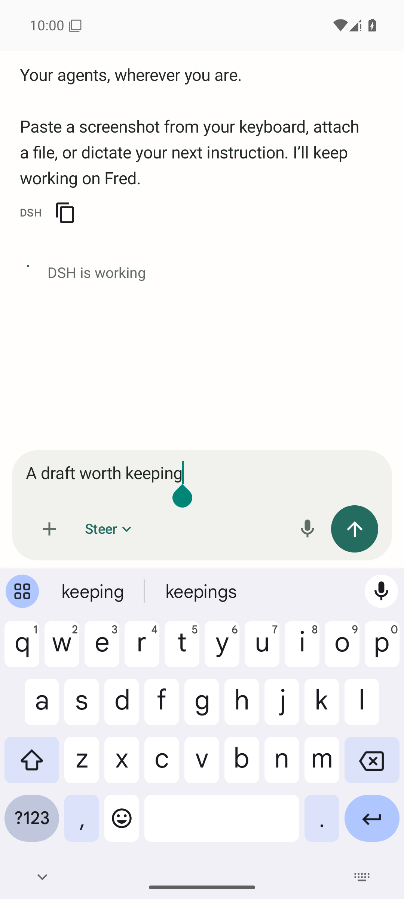

# Relay for Android

## 0.1.20: definite rejection and uncertain-draft recovery

A queue lock or pending interaction can appear between native-state preflight and dispatch. The gateway now marks delivery as attempted only at the adapter call; definite `DeliveryDeferred` rejections return 422 and preserve the draft instead of creating false uncertain delivery. Replaying a failed task cannot be reported as success; genuinely ambiguous native calls remain uncertain.

Android offers **Keep draft / clear notice** after an uncertain delivery. Confirmation explains that the agent may have received the earlier message. Clearing the notice preserves the current draft and attachments, sends no request, and does not change the gateway receipt. Original-key Retry safely remains available. Definite rejections also clear stale outgoing indicators when the user has switched to another session.

## 0.1.19: tailnet DNS and restart recovery

Signed builds made on the gateway's Tailscale host provision its Self DNSName and IPv4 tailnet address from `tailscale status --json`. If system DNS fails for that exact hostname, Android can connect to the provisioned address. The request URL, HTTPS hostname, SNI and certificate validation stay unchanged. Other hosts use normal DNS; invalid/non-tailnet pins fail closed. CI/off-tailnet builds have no auto-provisioned pin. A working Tailscale connection is still required.

Successful restart receipt checks clear stale connection errors. The gateway also reconciles late native resume bindings, restores the conversation title and selected model, and continues the known Claude project-trust startup prompt for authorized launches/resumes. Existing session permissions remain in force.

## 0.1.18: provider restart and file saves

Hold a supported session → **Swap provider** to resume its exact conversation with a selected provider/model/permissions. Web has the equivalent action. See [support and recovery limits](PROVIDER_SWAP.md).

Saves use one activity-level document picker and ViewModel work instead of launchers/coroutines inside scrolling message rows. Relay fetches into private cache first and rejects non-2xx, empty or truncated responses before opening the picker. Replay/virtualization cannot discard the pending source or cancel its copy. Source/destination metadata survives activity recreation; a destination copy can resume after process recreation. Storage-provider write failures still produce an error and may leave an incomplete destination.

Published attachments remain downloadable after exact resume changes owner generation. Unpublished drafts and files from other native conversations remain inaccessible; old-generation files cannot be reused as new agent inputs without re-upload. Local-path links never published as attachments remain unsupported.

Kotlin tests cover binary copying and empty/truncated rejection. Backend tests cover historical ownership. Physical system-picker verification remains outstanding.

A native Kotlin / Jetpack Compose client of the existing Relay gateway. This is **not a WebView or installed browser page**. Herdr and the gateway continue to own agent sessions. Android 9+ is required.

## Install

Keep Tailscale connected on the phone. Open Relay web settings → **Download Android APK**, open the download, and allow installation from that source when Android asks. The package is `pro.skinnyc.relay`, separate from the existing PWA. The APK is server-independent. On first launch, enter your own Relay HTTPS origin, for example `https://your-server.your-tailnet.ts.net:11543`. No server URL, tailnet name or IP is embedded. Settings → Connection lets you change servers later. Existing explicitly saved server addresses survive updates; installations that previously relied on the old implicit default will enter their server address once.

Your phone and server must be on the same tailnet (or have an explicitly shared/authorized Tailscale path). Configure Relay’s tailnet endpoint and allowed node identities on your server, keep Tailscale connected, and use a hostname with a valid trusted HTTPS certificate. A raw `100.x` URL generally will not match a hostname certificate. If Android DNS is unreliable, enter the server’s Tailscale IPv4 address in **Tailscale IP (optional)**; it is a DNS-only fallback for that configured hostname, preserving TLS verification. Changing the server clears the live selection and notification cursor; drafts and pending launch receipts stay scoped to their server.

CFRproxy and Herdr run on your server, not inside the APK. Configure that Relay server’s launch profiles to invoke `cfrproxy` for the desired harnesses inside Herdr. The APK reads available hosts, models, permission presets and project roots from that server’s launch catalog. No machine needs to be named Fred. Speech/cleanup and DSH are optional server capabilities. See [the agent installation guide](AGENT_INSTALL.md) for the complete stack.

The initial build uses tailnet authentication. Pairing outside the tailnet is not implemented in this client; unauthenticated requests fail closed. No pairing keys or service credentials are embedded in the APK. Android TLS certificate checks stay enabled. Cleartext is disabled in release builds. Debug tests alone allow localhost HTTP.

## Native interaction

- Native session drawer with edge swipe, search, harness filtering, saved sessions, profile/model/CWD, long-press rename/pin/archive, and confirmed turn interruption where supported.
- Native Android text editor receives clipboard and keyboard images through AndroidX `OnReceiveContentListener`. Plain text retains normal selection, IME composition, and paste behavior. Image URIs are copied while holding their temporary permission lease, bounded to 20 MB, then uploaded through the authenticated gateway. Up to 10 attachments. File/photo picker, camera intent, and Android Share → Relay are supported; sharing requires confirmation of the destination session and never sends automatically.
- Send/Steer is the default when supported. Queue remains an explicit alternative. All native actions obey gateway capability flags. Each message request gets a durable idempotency key before transmission. Ambiguous delivery is preserved and only manually retried with the same key. Closing or disconnecting the app does not stop the agent.
- Stable event IDs, live WebSocket updates, history pagination, completed-message replacement of deltas, selectable Markdown, expandable tool activity, image previews, pinch zoom, and Save through Android's document picker. Native gateway-published media stays behind session authorization.
- Structured DSH and Codex question groups, multiple choices, free text and approvals respond to their exact native interaction. Expired/uncertain interactions cannot be submitted. Model and permission changes use gateway APIs and explicit permission-change confirmation.
- Session creation uses the gateway launch catalog, including DSH agent presets, model selection, custom models where enabled, and folder browsing on the selected server.
- Native microphone recording (AAC/MP4, up to 180 seconds) shows a live input meter, stop and cancel. The gateway uses its configured speech and cleanup services; cleaned text is appended to the current draft and never submitted automatically. Failure retains the recording for explicit retry until cancel/session change; successful recordings are deleted. Leaving the app stops microphone capture. Original transcription is available for review.
- System theme, 48dp targets, native keyboard insets, hidden header while typing, font scaling, and first Back opening the session drawer. No web history trick is involved.

## Build

Requires JDK 21, Android SDK platform 36, build tools, and accepted SDK licenses:

```sh
apps/android/gradlew -p apps/android testDebugUnitTest lintDebug assembleDebug assembleDebugAndroidTest
python3 scripts/build-android.py --publish ~/.local/state/relay
```

`local.properties` can supply `sdk.dir`; it is ignored by Git. The Gradle wrapper is checked in. Versions are pinned to the locally validated toolchain. Dependencies are AndroidX/Compose (Apache-2.0), OkHttp (Apache-2.0), Coil (Apache-2.0), Markwon/CommonMark (Apache-2.0/BSD-2-Clause), and Kotlin/coroutines (Apache-2.0). No Claude or ChatGPT assets/code were copied.

The release script creates a private signing key once under `~/.local/share/relay/android-signing` with restricted permissions. **Back up that directory securely**: Android requires the same signing key for future app updates. No keys or passwords are committed or embedded in CI. CI produces a debug APK; privately signed release APKs can be built on any configured build host. Increment `versionCode` and `versionName` for subsequent published releases.

The gateway serves operator-published files under `/api/android` (metadata/checksum) and `/api/android/apk` (download), both authenticated. No client-provided filesystem paths are accepted.

## Validation and limits

Unit tests cover event replay, stream completion, native capability gating, question-envelope presentation, and request identity. Android instrumentation tests exercise the actual input connection, rich-content MIME advertisement, keyboard `commitContent`, long-press clipboard paste, native recording into an editable draft, Back navigation, Send/Steer routing, and activity recreation. Speech service output is mocked in deterministic instrumentation tests; live speech service verification is separate.

Run instrumentation on an emulator or test phone after installing both debug APKs:

```sh
adb install -r apps/android/app/build/outputs/apk/debug/app-debug.apk
adb install -r apps/android/app/build/outputs/apk/androidTest/debug/app-debug-androidTest.apk
adb shell am instrument -w pro.skinnyc.relay.test/androidx.test.runner.AndroidJUnitRunner
```

The instrumentation APK clears **only this app's local test data**; do not run it on your daily installation. Test content is isolated from real agents.

Still requires a physical-phone pass for the user's keyboard, camera provider, microphone quality, gesture navigation, TalkBack, and OEM battery management. Private background notifications are available from 0.1.23; real-time spoken conversation is not implemented. Dictation is record → transcribe/clean → review; it is not a clone of proprietary voice infrastructure. The web application remains available on Android, iOS and desktop. Advanced web-only features should continue to be used there until explicitly implemented and verified in Android.

### Verified on Fred, 2026-10-09

- Eight native unit tests passed; Android lint has zero errors (17 dependency/modernization warnings).
- Seven Android 15 Google APIs emulator instrumentation tests passed: IME image commit, native long-press paste, AAC recording → cleaned draft, first Back/drawer and Send/Steer routing, recreation/draft retention plus keyboard geometry, exact DSH question response, and uncertain delivery retry with the original request ID.
- 91 gateway tests and two installer browser tests passed; TypeScript checking, ESLint and web build passed.
- A short synthesized speech sample, encoded as AAC/MP4 (the native recording format), was sent through Fred to the real Gary ASR/cleanup services. Result returned in 1.96 seconds with `cleaned: true` and preserved the original question. This measures that sample and current server load, not a latency guarantee.
- The privately signed, shrunk release APK is approximately 2.8 MB and passes `apksigner verify`.



The screenshot uses isolated fixture conversation content. The Android input test actually advertises `image/*` and accepts `InputConnectionCompat.commitContent`; it is not a desktop paste simulation.

### 0.1.1 interaction fixes

- Reading older messages suspends automatic following immediately. New messages/tool events preserve the reading position; Latest messages resumes following. Delayed auto-scroll checks user intent again before moving.
- Session drawer sorts working agents first, then sessions needing input, idle sessions, and saved/ended sessions. Each group uses newest activity first, with deterministic ties. Pins do not hide currently working agents below idle sessions.
- Returning via the launcher does not open a share-import dialog. Only Android SEND/SEND_MULTIPLE intents trigger import; dismissed/consumed shares remain dismissed across activity recreation.
- Back from a conversation opens the session drawer repeatedly, rather than backgrounding the app after the first use.

Install the signed 0.1.1 APK over 0.1.0 to retain drafts and settings. Native changes require installing the APK update; refreshing the web app does not update the Android client.

0.1.1 validation: nine unit tests and nine Android emulator integration tests passed, including preserved scroll offset across messages/tools/repeated idle refreshes, repeated Back, and launcher re-entry/recreation. Real Android SEND → Cancel → Home → launcher was also checked with UI Automator: the import dialog did not return. Android lint and signed release build passed. Physical-device confirmation remains outstanding.

### 0.1.2 conversation presentation

Claude background-task notifications, including native result payloads, render as expandable task summaries instead of user-message XML. Results and diagnostic fields remain available; complete recognized envelopes are formatted, while code examples, partial data and unrecognized structures remain literal. Stored source events are unchanged. The web formatter also accepts the result field.

User messages display Sent and agent messages display Received with the source event date/time in the phone timezone and locale. Missing/invalid native timestamps are omitted rather than replaced with the current time. This is the recorded event time, not a new delivery receipt. Install 0.1.2 over the existing Android app.

0.1.2 validation: 11 native unit tests and all 10 Android emulator integration tests passed, including task-result expansion and sent/received timestamps. The mobile web task-notification rendering test passed across the configured phone/tablet/desktop widths. An emulator System UI ANR initially obscured two native focus/clipboard tests; restarting that emulator component resolved the interference, and the complete suite then passed.

### 0.1.3 send recovery

A durable confirmed gateway receipt now resolves an uncertain Android send even when the native transcript echo has not arrived. Reconciliation preserves a newer draft and does not submit another message. The gateway marks failures before any delivery attempt as a definitive rejection (HTTP 422) and removes the unused receipt, keeping them out of uncertain-delivery recovery. Errors after a native delivery attempt retain the original idempotency key and remain uncertain. Existing CLI Codex question/approval routing is unchanged by this delivery fix.

### 0.1.4 native Codex questions and session settings

Session details now separates permission profiles from Build/Plan mode. Supported settings come from the gateway’s native adapter; each change requires confirmation and read-back from the harness. Existing Codex daemon questions render as structured cards, send the exact native answer object, recover after reconnects, and disappear after external resolution. Native CLI command/file approvals and Claude permission/mode controls are not included.

Validation: 104 backend tests, 11 Android unit tests, 13 emulator instrumentation tests, and two mobile browser regressions passed. Android lint, debug/test builds and signed 0.1.4 release build passed. The initial emulator runs were obstructed by Launcher/System UI ANR dialogs; after restarting those emulator components and dismissing their dialogs, the complete 13-test suite passed. Native screenshots with keyboard open and closed were inspected. Live Codex question replay/response and permission/mode changes were verified on an isolated test thread. Physical-phone verification remains outstanding.

Install 0.1.4 over your existing app to get the separate mode selector and readable custom-policy labels. Gateway question routing works with the existing structured-question UI too. Settings affect subsequent turns; Plan mode does not silently change permission profiles.

## 0.1.5: project creation and permissions

New session now creates a folder directly in the configured home and selects it. Launch permission choices require confirmation; session permissions and mode controls appear above metadata in Session settings. Install the new APK over the existing app to keep pairing, drafts, and preferences. The gateway-only update does not add native UI controls to older APKs.

Validation: 14 disposable-emulator integration tests pass, including the new folder/permission flow and existing Back, clipboard, dictation, interaction, draft and recovery tests. The first cold-boot run was blocked by an emulator System UI ANR; after clearing it the full suite passed. The launch flow also passed in dark mode. Unit tests, lint, debug/test builds and signed release build passed. Physical-phone and exhaustive live-harness launch verification remain separate.

Screenshots: [Android launch](screenshots/launch-permissions-android.png), [dark mode](screenshots/launch-permissions-android-dark.png).

### 0.1.6: links and native approval parity

Markdown link taps now open the system browser, including APK downloads. Relative
HTTP(S) links resolve against the configured gateway. Long-press still selects text;
dragging does not follow a link. Executable/local URI schemes are rejected. Published
image/file artifacts retain their existing in-app preview and Save controls; arbitrary
local paths in prose are not downloadable files.

The previous selectable TextView installed Android's selection movement method,
which prevented Markwon from installing link handling. A selection-preserving view
now distinguishes a short link tap from a drag or long press. Instrumentation verifies
one browser launch per tap and retained text selection on long press. It also verifies
Codex approval choices use only the interaction response endpoint.

### 0.1.7: clear submitted drafts and dictation originals

Sending clears the submitted composer text and original-transcription panel together,
without waiting for the HTTP response. Recovery data is saved first. Failed delivery
restores the original when no newer draft has been edited; safe retries retain the
request ID and original whitespace. Late acknowledgements preserve the next draft.

### 0.1.9: consolidated activity

Consecutive tool calls, tool outputs and reasoning summaries appear under one collapsed **Agent activity** row between messages. Tap to expand; individual details remain available. Expansion survives incoming events and the row has a 48dp minimum target plus an accessibility state. Artifacts and questions remain separate.

Validation: Android unit tests (including grouping boundaries and stable identity), lint and debug/test APK compilation passed. A disclosure interaction regression test was added and compiled, but not executed: the local emulator system image was missing and its replacement download was too slow to complete. Physical-device visual verification remains outstanding.

## 0.1.14: native Codex delivery and session models

Install the signed 0.1.14 APK over your current app. Tap the conversation title or **Session details** to choose **Model for next request**. The control appears only for adapters advertising native model changes (verified Codex and DSH). A running turn keeps its current model. Model loading remains available when a separate permissions request fails.

The gateway fixes Codex Send and initial session instructions through the existing daemon; this delivery fix also applies to older APKs. Android 0.1.14 adds the model picker and labels pending native echoes accurately. See CLIENT_PARITY.md for live Fred validation and remaining platform limits.

## 0.1.15: rich responses and media

Install the signed update over your existing app to retain drafts and settings. Assistant OpenUI blocks and published `.openui` files render as interactive artifacts. Cards, charts, tables, forms, tabs and other installed components share the web renderer. Navigation and the composer remain Kotlin/Compose; the bundled artifact surface has no arbitrary network or agent tools. Forms add a draft for review.

DSH file links save through the document picker; MP4/video and audio have native playback, seek and video fullscreen controls. No filesystem link launches Relay's homepage. Passive media API responses are session-authorized and support byte ranges. See OPENUI.md for exact format, limits and physical-device checks.

Version 0.1.16 adds **Agent tasks → Sub-agent conversations** for linked Claude and Codex native histories. These child chats are view-only: there is no Send/Steer composer. DSH's native `todo_write` checklist now appears under Agent tasks through the shared gateway fix.

0.1.20 release validation: 21 JVM tests, lintDebug, instrumentation APK compilation and the signed release build pass. Published APK SHA-256: `b89be506f09bb214ba9e8ee03f6021309662e29fa9c665b62955a873b34d1cf8`; `apksigner verify` passes and the authenticated HTTPS download matches that checksum. The gateway pre-dispatch regression is covered in the 159-test shared suite; browser checks also cover rejected-draft restoration and retained uncertainty after transport loss.

### 0.1.21 QOL update

Adds the session command center, persistent pending-question tray, task progress, AMOLED and reading/activity/haptic preferences, text/code artifact previews and Android file sharing. Returning from settings retains the conversation's saved scroll position. Shared artifacts use authenticated downloads and temporary read-granted FileProvider URIs. PDF/Office files remain downloadable/shareable; text/code previews are limited to 256 KB.

Unit tests, lint, debug and instrumentation APK compilation are required for this release. Physical-device checks remain necessary for share targets, system font scaling, keyboard/insets, vibration, and restoration after Android process eviction; no desktop browser result substitutes for those checks.

### 0.1.22 native validation and delivery recovery

A confirmed gateway receipt now moves an uncertain Android message to accepted and unlocks the composer. Its bubble remains until native history acknowledges it. Recovery preserves newer drafts and transcription text and never resends the request automatically, matching web receipt recovery.

All 23 instrumentation tests passed on a disposable Android 15 x86_64 emulator, including native clipboard/IME image input, Back, keyboard insets, question responses, delivery recovery, dictation drafts, model controls and settings persistence. A strengthened late-receipt/new-identical-draft test also passed separately. Added coverage for AMOLED/reading/activity/spacing/haptic preference persistence and pending-question visibility/expiry with responses-only filtering. Native keyboard-open/closed screenshots were reviewed. Unit tests, lint and debug/test builds passed. Physical-phone share targets, vibration and OEM keyboard/font behavior remain separate checks.

Signed 0.1.22 (versionCode 23) published and verified through authenticated, certificate-validated Tailnet HTTPS: 4,898,869 bytes, SHA-256 `9711f062099a95373c83047e85bc7cb66d08f22cfa77341b67e43c51b33561cb`. The disposable emulator was stopped and its temporary KVM ACL restored.

### 0.1.23 private background notifications

Enable **Settings → Background notifications**, then allow Android's notification permission. Select questions/approvals, completed turns, and failures independently. Android channel settings control sound and vibration; session-name previews can be hidden. Tap a question alert to open its session's answer tray; tap a completion to open the chat. No notification action sends a message or accepts an approval.

The installed app uses an opt-in foreground connection over the authenticated Tailscale HTTPS/WebSocket endpoint. It does not require Firebase credentials or send chat content to a cloud push provider. Android displays a quiet “Relay notifications” connection notification with a Pause action. It resumes after reboot/package update when enabled. Keep Tailscale connected and set Relay battery use to **Unrestricted** for timely delivery while asleep. Android Doze/OEM battery controls can delay a private socket, and force-stopping the app stops delivery until it is reopened. This is private socket push, not FCM wake delivery.

A durable server cursor catches up after reconnect, per-event receipt persistence prevents replay alerts, and alerts collapse by session/category. The first connection establishes a baseline instead of notifying for old history; catch-up is limited to events after enabling and within 24 hours. Question alerts are removed when answered or expired. Session-status changes and transcript imports predating enablement never generate notifications. Archived sessions and unauthorized sessions are filtered by the gateway. Notification content is private on the lock screen; session names are the only preview, never question/tool/message text.

Web notifications now also recognize native turn completion. Browser notifications still require the web app to be running; closed-browser Web Push is not implemented. APK users must install the new version and enable notifications once.

Transport contract: `GET /api/notifications` establishes a cursor without replay. Subsequent `?after=<cursor>&since=<enable-time-ms>` reads return bounded pages of authorized alerts plus active question session IDs; persist the returned cursor only after processing. `/ws?notifications=1` supplies content-free wakeups and rechecks device authorization. HTTP performs the durable catch-up. Existing `/ws` conversation behavior is unchanged. Android limitations follow [Doze and App Standby](https://developer.android.com/training/monitoring-device-state/doze-standby) and the [special-use foreground service requirements](https://developer.android.com/develop/background-work/services/fgs/service-types#special-use).

Validation: all 166 backend tests, TypeScript and ESLint passed. All 25 Android instrumentation tests passed on the disposable Android 15 emulator after fixing notification-intent consumption to preserve Activity launch identity. Coverage includes delivery with the Activity stopped, question/completion channels, repeated-feed deduplication, opening the answer tray without submitting chat, disabling the service, and preference persistence. Unit tests, lint and debug/test APK builds passed; the notification settings screenshot was reviewed. Actual phone sleep/OEM battery behavior, notification sound/haptics and boot delivery still require a physical-device check. The test emulator and temporary KVM permission were cleaned up.

Delivery: gateway/web `41386fa` deployed and healthy. Signed APK 0.1.23 (versionCode 24) published; authenticated certificate-validated Tailnet download returned 4,929,685 bytes with SHA-256 `ab82f4e8e635dc2ae4041f9b22662888f34a7b1decb85e78375c7c17127dfafe`. The live notification endpoint returned a valid empty-history baseline.

## 0.1.26: native commands and shortcut menu

Install over the existing app to retain pairing and drafts. A keyboard button
opens quick shortcuts; typing `/` displays common command suggestions. Slash
commands use Relay's native control path, and quick replies keep a separate
draft intact. Stop/Ctrl+C and Escape respect connection capabilities; pending
questions must be answered using their cards. See [session commands](SESSION_COMMANDS.md).

Android unit tests, lint and debug/test APK builds pass. A dedicated native
instrumentation regression was added and compiled. Emulator execution and
keyboard/font-scale screenshots remain unverified because the local disposable
AVD's system image is missing; desktop Chromium results are not native-device
validation.

### 0.1.27: visible running tool commands

Current commands and elapsed time stay visible above the composer instead of
being hidden in Agent activity. Long waits explain missing output and provide
Stop current turn without discarding a draft. With the native observer enabled,
the app shows retained DSH terminal output while a command runs; the bridge is
read-only. See DSH_TERMINAL.md for activation and limitations. Native unit tests/lint/builds pass; the new UI test is compiled
but has not run on an emulator or physical phone.
